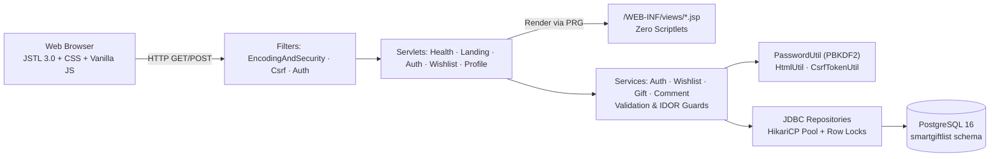
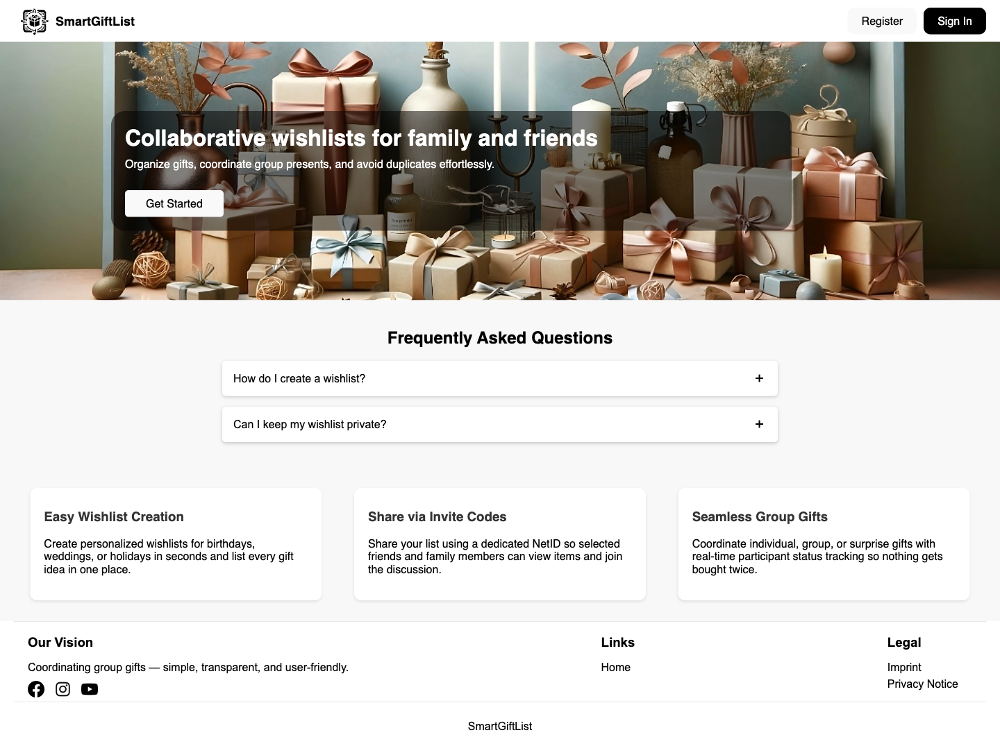
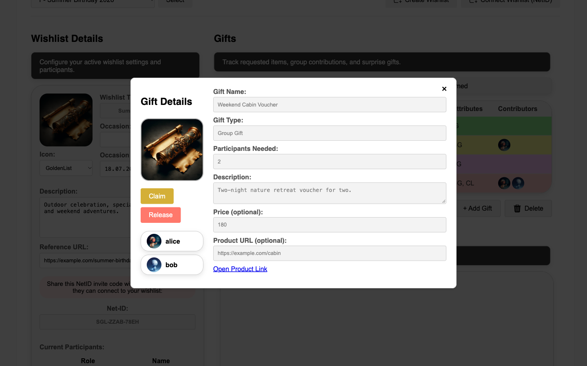
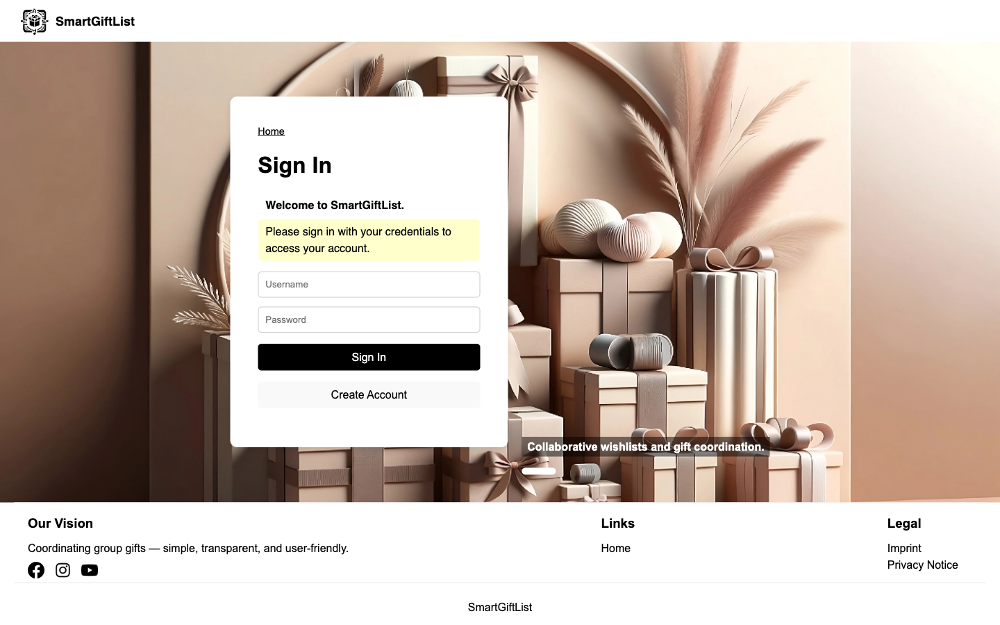
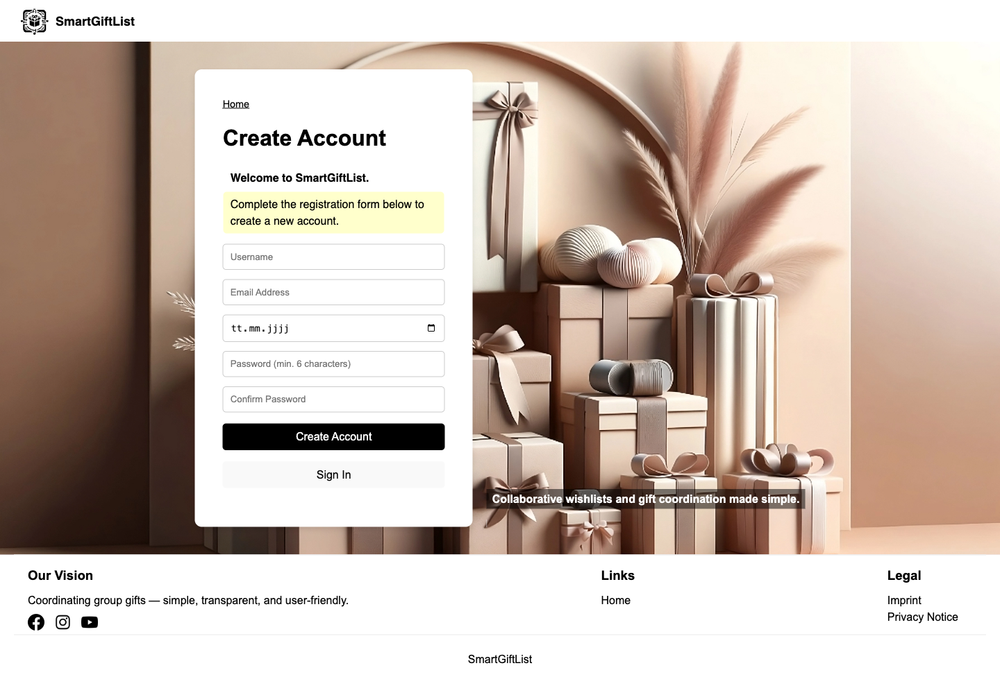

# SmartGiftList

> **Collaborative gift wishlist web application built with Java 21, Jakarta EE 6 Servlets/JSTL, HikariCP + JDBC, and PostgreSQL 16 — packaged with a reproducible Nix Flake, Gradle WAR build, and Docker/Podman end-to-end runtime stack.**

[](./LICENSE)

[](https://github.com/NiklasJavier/SmartGiftList/actions/workflows/ci.yml)
[](./build.gradle)
[](./docker/init.sql)
[](./flake.nix)

---

> [!NOTE]
> **Project Context:** SmartGiftList was my very first software and web development project, originally written with JSP scriptlets to learn server-side Java and SQL modeling. It has since been sanitized and refactored into a clean layered **Jakarta Servlet 6 MVC + JSTL 3.0 + HikariCP** architecture for reproducible local runs and testing, while remaining **archived as a completed reference with no ongoing feature roadmap**. Default credentials in [`.env.example`](./.env.example) are strictly for local evaluation — see [`SECURITY.md`](./SECURITY.md) before reusing any component.

---

## Quickstart (End-to-End Go-Live & Verification)

**1. Install prerequisites:** [Docker](https://docs.docker.com/get-docker/) or [Podman](https://podman.io/) (`scripts/stack.sh` supports Docker Compose v2/v1, `podman compose`, `podman-compose`, and rootless `podman`), plus [Nix](https://nixos.org/download/) with Flakes enabled (`flake.nix` provides **JDK 21**, **Gradle**, `just`, `curl`, `jq`, `shellcheck`, `python3`, `ruby`, `postgresql_16`, and `tomcat10` for zero-container E2E runs):

- **macOS / Linux:** `curl --proto '=https' --tlsv1.2 -sSf -L https://install.determinate.systems/nix | sh -s -- install` (official alternative: [nixos.org/download](https://nixos.org/download/))
- **Windows:** Enable [WSL2](https://learn.microsoft.com/en-us/windows/wsl/install) and turn on Docker Desktop / Podman WSL2 integration, then run the same Nix installer inside your WSL2 Linux shell.

**2. Verify, boot, and smoke-test end-to-end:**

```bash
# Clone, enter reproducible dev shell, verify WAR build, JUnit 5 tests, configs, docs & privacy
git clone https://github.com/NiklasJavier/SmartGiftList.git && cd SmartGiftList
nix develop
just doctor && just check

# Container path (Docker or Podman): start PostgreSQL 16 + auto-connected Tomcat 10.1
just up

# Live 12-step E2E check: /health -> auth/CSRF guards -> register -> login -> wishlist -> group gift -> IDOR -> profile -> logout
just verify-e2e
# Browse interactively at: http://localhost:8080/

# Stop containers and delete network state & ephemeral DB volumes
just down

# Zero-container Nix path (when neither Docker nor Podman is installed):
just test-e2e-local   # runs local-up (Nix PostgreSQL 16 + Tomcat 10.1) -> verify-e2e -> local-down
```

Manual container/Gradle usage without Nix, environment variable overrides, and `just local-up` / `just local-down` details live in [docs/getting-started.md](./docs/getting-started.md).

---

## Architecture & Core Capabilities

SmartGiftList uses a layered **Jakarta Servlet 6 MVC architecture** backed by pooled **HikariCP JDBC** connections, **JSTL 3.0** views (`scripting-invalid=true`), and **PostgreSQL 16**:



### Features Implemented

- **User Onboarding & Profile Management:** Registration (`/register`), PBKDF2-HMAC-SHA256 authentication (`/login`) with session ID rotation, optional-password profile updates with avatar selection (`Lumibella`, `Novaterra`, `Quixart`) on `/profile`, CSRF protection (`_csrf`), and cascade account deletion.
- **Personal & Shared Wishlists (`SGL-XXXX-XXXX` Invites):** Create themed wishlists (`PaperList`, `BronzeList`, `SilverList`, `GoldenList`), edit metadata/event dates (owner-enforced), and invite friends or family via a high-entropy random `NetID`.
- **Gift Types & Atomic Claim Coordination:**
  - `IG` (**Individual Gift**) — single-contributor item
  - `GG` (**Group Gift**) — multi-contributor item tracking participant capacity atomically via `FOR UPDATE`
  - `SG` (**Surprise Gift**) — marks surprise items for wishlist planning
  - `CL` (**Claimed**) — automatically flips row status once participant slots are filled
- **Per-Wishlist Discussion Feed:** Member-scoped chat messages with timestamp ordering and one-click withdrawal of the user's latest comment.

---

## Views & Screenshots

Captured from the live Servlet 6 / PostgreSQL 16 application (`1440x900` desktop viewport):

| Landing Page | Gift Details & Claiming Modal |
| :---: | :---: |
| [](./docs/screenshots/landing.png) | [](./docs/screenshots/gift-details-modal.png) |
| Hero overview, FAQ accordion, and feature highlights (`/`) | Participant capacity tracking and claim/release actions (`?openDetails=1`) |

| Sign In | Registration |
| :---: | :---: |
| [](./docs/screenshots/login.png) | [](./docs/screenshots/register.png) |
| Credential authentication view (`/login`) | New account onboarding form (`/register`) |

| Profile Management | View Index |
| :---: | :--- |
| [](./docs/screenshots/profile.png) | **All 6 captured views:**<br>- [Landing Page](./docs/screenshots/landing.png) (`/`)<br>- [Registration](./docs/screenshots/register.png) (`/register`)<br>- [Sign In](./docs/screenshots/login.png) (`/login`)<br>- [Wishlist Dashboard](./docs/screenshots/wishlists.png) (`/wishlists`)<br>- [Gift Details Modal](./docs/screenshots/gift-details-modal.png) (`?openDetails=1`)<br>- [Profile Management](./docs/screenshots/profile.png) (`/profile`) |
| Avatar selection, credentials, and account deletion (`/profile`) | Full-resolution PNG captures stored in [`docs/screenshots/`](./docs/screenshots/). |

---

## Documentation & Navigation

| Document | Focus |
| :--- | :--- |
| [docs/README.md](./docs/README.md) | Documentation index |
| [docs/getting-started.md](./docs/getting-started.md) | macOS/Linux/Windows setup, manual build, env vars, 12-step E2E walkthrough |
| [docs/architecture.md](./docs/architecture.md) | Layered Servlet 6 MVC, HikariCP/JDBC repositories, services, JSTL views, JS/CSS |
| [docs/database-schema.md](./docs/database-schema.md) | PostgreSQL ER diagram, 6 relational tables, unique constraints, and indexes (`docker/init.sql`) |
| [docs/security-notes.md](./docs/security-notes.md) | PBKDF2 hashing, CSRF tokens, AuthFilter/IDOR guards, URL sanitization, HTML escaping |
| [.agents/README.md](./.agents/README.md) | Agent & contributor codebase index and `repo-skills` guide |

Community & governance: [`CONTRIBUTING.md`](./CONTRIBUTING.md) · [`SECURITY.md`](./SECURITY.md) · [`CODE_OF_CONDUCT.md`](./CODE_OF_CONDUCT.md) · [`CHANGELOG.md`](./CHANGELOG.md) · [`LICENSE`](./LICENSE) (Apache-2.0)
