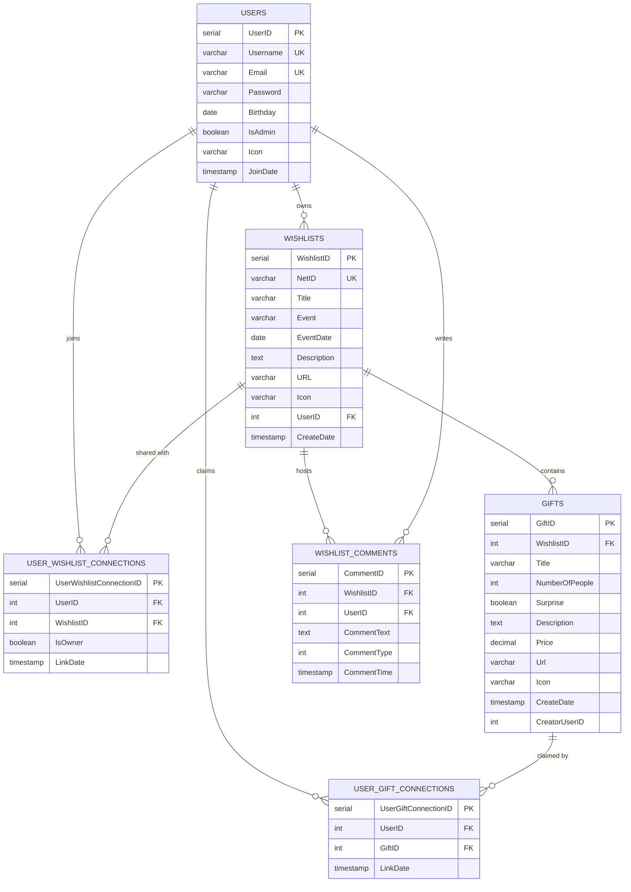

# PostgreSQL Database Schema

SmartGiftList stores users, wishlists, shared wishlist memberships, gifts, gift claims, and wishlist discussion comments inside a single configurable PostgreSQL schema (`DB_SCHEMA`, default `smartgiftlist`).

On container startup, [`docker/init.sql`](../docker/init.sql) creates the schema, all six tables, uniqueness constraints, and indexes automatically; [`SchemaInitializer`](../src/main/java/dev/smartgiftlist/config/SchemaInitializer.java) ensures the identical structure idempotently when the application boots.

---

## 1. Entity-Relationship Diagram

---

## 2. Table Contracts, Constraints & Indexes

| Table | Purpose | Cascades, Constraints & Indexes |
| :--- | :--- | :--- |
| `Users` | Registered accounts with PBKDF2 password hashes and avatar choice | `Username` and `Email` `UNIQUE NOT NULL` |
| `Wishlists` | Wishlists created by an owner (`UserID`) with shareable `SGL-*` `NetID` | `NetID` `UNIQUE NOT NULL`; `ON DELETE CASCADE` from `Users`; index `idx_wishlists_user` |
| `Gifts` | Requested items (`NumberOfPeople >= 1`, optional `Surprise`, `DECIMAL(10,2)` price, URL) | `ON DELETE CASCADE` from `Wishlists`; index `idx_gifts_wishlist` |
| `UserGiftConnections` | Tracks participant claims (`COUNT <= NumberOfPeople`) | `UNIQUE (UserID, GiftID)`; `ON DELETE CASCADE` from `Users` & `Gifts`; index `idx_ugc_gift` |
| `UserWishlistConnections` | Links invited friends to shared wishlists (`IsOwner` flag) | `UNIQUE (UserID, WishlistID)`; `ON DELETE CASCADE` from `Users` & `Wishlists`; index `idx_uwc_user` |
| `WishlistComments` | Per-wishlist discussion (`CommentType = 1`) and system events (`CommentType = 2`) | `CHECK (CommentType IN (1, 2))`; `ON DELETE CASCADE` from `Wishlists` & `Users`; index `idx_comments_wishlist_time` |
