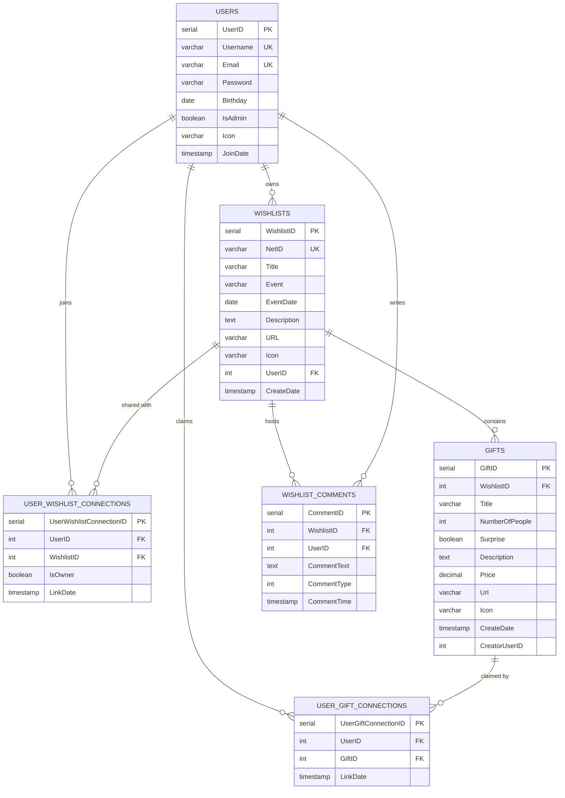

# PostgreSQL Database Schema

SmartGiftList stores users, wishlists, shared wishlist memberships, gifts, gift claims, and wishlist discussion comments inside a single configurable PostgreSQL schema (`DB_SCHEMA`, default `smartgiftlist`).

On container startup, [`docker/init.sql`](../docker/init.sql) creates the schema and all six tables automatically.

---

## 1. Entity-Relationship Diagram

---

## 2. Table Contracts & Integrity Rules

| Table | Purpose | Cascades & Constraints |
| :--- | :--- | :--- |
| `Users` | Registered accounts with PBKDF2 password hashes and avatar choice | `Username` and `Email` `UNIQUE` |
| `Wishlists` | Wishlists created by an owner (`UserID`) with shareable `NetID` | `NetID` `UNIQUE`; `ON DELETE CASCADE` from `Users` |
| `Gifts` | Requested items (`NumberOfPeople` slots, optional `Surprise` flag, price, URL) | `ON DELETE CASCADE` from `Wishlists` |
| `UserGiftConnections` | Tracks which users claimed slots on a gift (`COUNT <= NumberOfPeople`) | `ON DELETE CASCADE` from `Users` and `Gifts` |
| `UserWishlistConnections` | Links invited friends to shared wishlists (`IsOwner` flag) | `ON DELETE CASCADE` from `Users` and `Wishlists` |
| `WishlistComments` | Per-wishlist discussion (`CommentType = 1`) and system events (`CommentType = 2`) | `CHECK (CommentType IN (1, 2))`; `ON DELETE CASCADE` from `Wishlists` & `Users` |
